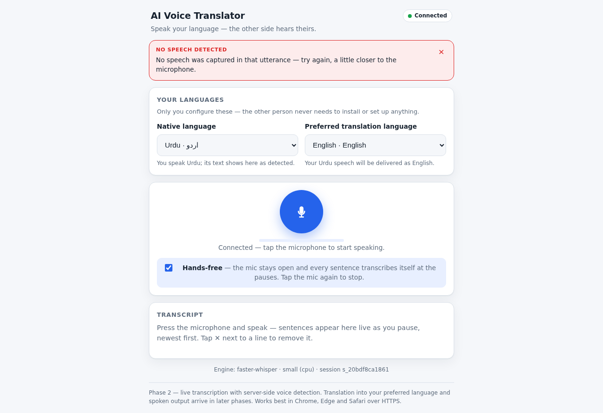

# AI Voice Translator

Real-time, AI-powered voice translation for two-person conversations: **only
the translator user** configures a Native Language and a Preferred Translation
Language — the other person installs and configures nothing. The system
detects what language each side speaks, translates only the configured pair in
the required direction, and passes every other language through untouched.

> **Status — Phase 6 complete (of 10): mobile/browser compatibility.** Working today:
> responsive browser UI (mobile-first), microphone capture, real-time
> streaming to the backend, **local CPU speech recognition (Whisper, no
> GPU)** with automatic language detection (detect-first, then a pinned
> decode — ADR-0012), live transcript with RTL support, **server-side
> Silero voice-activity gate (silence/noise never decoded)**,
> edge-trimmed and pause-segmented utterances, **hands-free continuous
> mode**, backpressured bounded queues, per-line transcript delete, the
> **translation decision engine** (your language is translated for the
> other side, theirs for you, any third language passes through untouched
> — **offline by default**, CTranslate2 OPUS-MT, no API keys), **offline
> Piper spoken output** (Urdu, English, Spanish — no GPU, no keys) through
> a sequential playback queue that can never overlap, **two-person
> sessions** (share an invite link; transcripts with speaker labels;
> translated voices reach only the listener; a playback guard prevents
> feedback loops — ADR-0014) and — new in Phase 6 — **mobile-ready
> behavior**: backgrounding the tab or an incoming call stops the capture
> honestly instead of streaming silence (ADR-0016), a screen wake lock
> keeps hands-free sessions alive, the app installs to a phone home
> screen (PWA manifest + icons), and the server sees which device
> families connect (`/health`). Verified under full device emulation in
> headless Chromium; the human real-device matrix lives in
> [docs/testing.md §13](docs/testing.md#13-phase-6--mobilebrowser-compatibility--actual-results-2026-11-06-adr-0016).
> Meeting integrations arrive in the next phases — see the [roadmap](#roadmap).



## Quick start

```bash
# 1) Backend (Python 3.11–3.12 + uv)
cd backend
uv sync                                                  # deps + venv
HF_HOME=../models/huggingface uv run python scripts/download_model.py   # ~490 MB, once
uv run python scripts/download_translation_models.py     # ~900 MB, once (offline MT: ur↔en, es↔en)
uv run python scripts/download_tts_voices.py             # ~190 MB, once (offline TTS: ur, en, es)

# 2) Frontend (Node 20+)
cd ../frontend && npm install && npm run build

# 3) Run everything on one port (SPA + WebSocket + health)
cd .. && bash start.sh          # → http://localhost:3000
```

Open `http://localhost:3000`, pick your languages — and **share the invite
link** shown on the page (`…?room=CODE`). The other person opens it in any
browser, taps the microphone and speaks: no install, no settings on their
side. Each sentence shows its decision — `UR → EN` with the translated text
below (RTL-aware) — and is **spoken aloud in the target language on the
LISTENER's device** (offline voices; pass-through speech is relayed as
original audio, never regenerated). Both sides see the shared transcript
with speaker labels. Keep the mic open with **Hands-free** enabled and
sentences transcribe (and translate) at every pause. Mute spoken output any
time with the **Spoken translations** toggle.

Development mode (HMR): `cd backend && uv run uvicorn app.main:app --port 8000`
plus `cd frontend && npm run dev` (Vite :5173 proxies API/WS).

## How it works

```
Browser A (host)              Browser B (guest)          Backend (FastAPI)
────────────────              ──────────────────         ────────────────────────────────
getUserMedia → AudioWorklet   getUserMedia → AudioWorklet
  (PCM16, 16 kHz, 100 ms)       (PCM16, 16 kHz, 100 ms)
        │  WebSocket /ws/audio — protocol v1 (docs/audio-protocol.md)
        │  host hello (ur→en) → ROOM CODE · guest hello (?room=CODE, configures nothing)
        ▼                           ▼
                     bounded buffer ──flush──▶ Silero VAD gate (Phase 2):
                     reject silence/noise (~13 ms), trim edges, split at pauses
                                   │ speech only (per connection)
                                   ▼
                     ThreadPoolExecutor (admission-capped → server_busy)
                     detect_language → resolve (ur/hi cluster + threshold)
                     faster-whisper decode pinned to the RESOLVED language
        ◀── transcription event (speaker-tagged) — BROADCAST to both ──▶
                                │ decision = translate (Rules 1–2 only)
                                ▼
                     TranslationService (rate-limited, ≤2 concurrent, 8 s timeout)
                     local CTranslate2 OPUS-MT  ·  libre (cloud, optional)
        ◀── translation event (speaker-tagged) — BROADCAST to both ──▶
                                │ TTS (ADR-0013) — routed to the OTHER participant (ADR-0014)
                                ▼
                     TTSService (rate-limited, ≤1 concurrent, 10 s timeout)
                     offline Piper voices: ur · en · es (models/tts/, no GPU)
        ── audio metadata + binary PCM16 (22 050 Hz) → LISTENER only ──
                     listener's SpeechPlayer: sequential queue, never overlaps;
                     remote playback guards the mic against feedback loops
                                │ decision = passthrough (Rule 3)
                                ▼
                     relay: ORIGINAL captured audio (16 kHz) → LISTENER only
                     (never regenerated with TTS, never replayed to the speaker)
```

Key properties: strict TypeScript (no `any`), versioned WebSocket protocol,
two-participant rooms with linger-based reconnection, bounded buffers +
admission-capped decode queue with `server_busy` backpressure (no unbounded
memory anywhere), server-side VAD gate, STT off the event loop,
stale-result rejection, uplink chunk dropping on stall, auto-reconnect with
backoff, privacy-conscious logging (transcripts never logged above DEBUG,
audio never persisted).

## Project layout

```
prompt.md            Phase 5 scope & delivery record (two-participant browser MVP)
PHASE-3.md           phase-3 branch only — Phase 3 deep dive
PHASE-4.md           phase-4 branch only — Phase 4 deep dive
PHASE-5.md           phase-5 branch only — Phase 5 deep dive
AGENT.md             permanent instructions for AI coding agents
backend/             FastAPI + faster-whisper (uv-managed; tests in backend/tests)
frontend/            React + Vite + TS strict (tests co-located in src)
docs/                architecture, protocol spec, testing results, deployment, ADRs
project-state/       CURRENT_STATE · TASKS · DECISIONS · KNOWN_ISSUES · CHANGELOG
start.sh             single-port production start (platform dev.sh calls this)
```

## Testing

```bash
cd backend && uv run pytest                # 171 passed + 1 documented xfail
cd backend && HF_HOME=../models/huggingface uv run pytest -m stt_real   # real-model STT tests
cd backend && uv run pytest -m translation_real                         # real offline MT tests
cd backend && uv run pytest -m tts_real                                 # real offline TTS tests
cd frontend && npm run typecheck && npm run lint && npm run test
bash start.sh   # then:
cd backend && uv run python scripts/e2e_synthetic_check.py --url ws://localhost:3000/ws/audio
cd backend && uv run python scripts/e2e_translation_check.py             # Rules 1–3 with real MT
cd backend && uv run python scripts/e2e_tts_check.py                     # Rules 1–3 + real spoken output
cd backend && uv run python scripts/e2e_phase5_check.py                  # TWO participants: routing + relay, real models
cd backend && uv run python scripts/silence_guard_check.py --url ws://localhost:3000/ws/audio
node frontend/scripts/smoke_phase2.mjs      # headless browser smoke — solo flow (fake mic)
node frontend/scripts/smoke_phase5.mjs      # headless browser smoke — host + guest via invite link
```

**Measured on 2 vCPU (no GPU):** VAD gate ≈ 13 ms per flush (silence/noise
never reaches the model), transcription ≈ 2 s for a 7 s utterance via
small+beam5 (RTF ≈ 0.3), real offline MT ≈ 110–160 ms per sentence, real
offline TTS at RTF ≈ 0.06–0.08 (a ~3 s sentence synthesizes in ~0.2 s warm;
the first sentence into a language pays ~1.5 s of voice load), spoken E2E
verified ur→en and en→ur with PCM amplitude checks, and the two-participant
E2E (4/4) proves routed delivery: each voice reaches ONLY its listener, and
third-language audio is relayed as captured. Full numbers and the honesty
list (what is *not* tested yet): [docs/testing.md](docs/testing.md).

## Known limitations (Phase 5)

- The local OPUS-MT models are honest-tier, not production-tier: everyday
  sentences translate correctly; nuanced Urdu→English is weak (small
  Tatoeba-scale models — [KI-012](project-state/KNOWN_ISSUES.md)). The
  provider abstraction makes upgrading a settings change
  ([ADR-0012](docs/decisions/0012-translation-decision-engine.md)).
- Urdu/Hindi share one spoken register: detection resolves them via the
  ur/hi cluster, and Urdu speech spoken to an en-native config may surface
  as Hindi-orthography text (KI-002; third-language corner case).
- Rooms are in-memory and single-process: a server restart ends every
  room, and an expired invite code dies with it (guests get an honest
  `room_not_found`). Room persistence/HA is **Phase 10**.
- Transcript line deletion is local-only (the peer keeps the line —
  KI-016); the host's language changes apply on the next connection
  (KI-017); a room holds exactly two participants (a third connection gets
  `room_full`).
- The feedback-loop guard mutes the uplink while REMOTE audio plays
  (+300 ms tail) — speaking over the other side's voice playback can clip
  the recording start; browser AEC covers most of the rest, and acoustic
  quality on physical hardware is part of the Phase 6 human matrix
  ([testing.md §13b](docs/testing.md)) — not yet run.
- Mobile behavior is verified under full device emulation in headless
  Chromium (ADR-0016); real Android/iOS hardware runs are the human
  checklist in [testing.md §13b](docs/testing.md) — until it is run, no
  hardware claims are made. Backgrounding the tab or an incoming call
  stops the recording honestly (by design), so the mic is never silently
  dead while the UI claims it is live.
- No authentication — intended for private/LAN/sandbox deployment (**Phase 10**).
- Piper `medium` voices are comprehension-grade, not human-equivalent; the
  Urdu voice (UAT dataset, eSpeak phonemization) can render anglicisms with
  an Urdu accent in mixed-language sentences. Upgrading is a settings change
  via the provider abstraction ([ADR-0013](docs/decisions/0013-tts-offline-piper.md)).
- The first synthesis into a language pays ~1.5 s of lazy voice load
  (measured, documented); later sentences synthesize at RTF ≈ 0.06–0.08.
- Meeting integrations (Zoom first) arrive in **Phase 7**.

## Roadmap (master prompt §17)

| Phase | Scope | Status |
| --- | --- | --- |
| 1 | Foundation + browser STT MVP | **complete** |
| 2 | VAD + audio optimization | **complete** |
| 3 | Translation decision engine (bidirectional) | **complete** |
| 4 | TTS + browser playback | **complete** |
| 5 | Complete browser MVP (two participants) | **complete** |
| 6 | Mobile/browser compatibility on real devices | **complete** (device emulation verified + human matrix ready; QA-hardened v0.6.1 — reconnect deadlock fixed, ADR-0017) |
| 7 | Zoom integration (first meeting app) | not started |
| 8 | Chrome extension / advanced audio | not started |
| 9 | More meeting apps (one at a time) | not started |
| 10 | Production readiness & release | not started |
